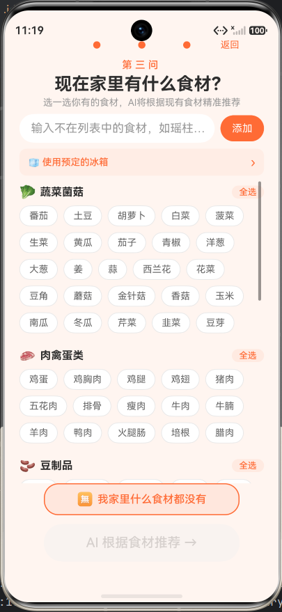
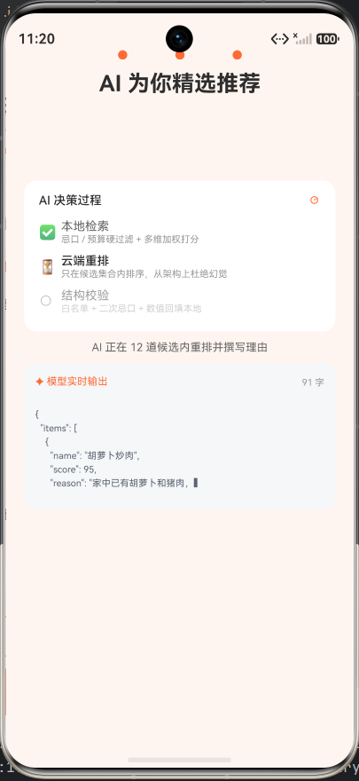
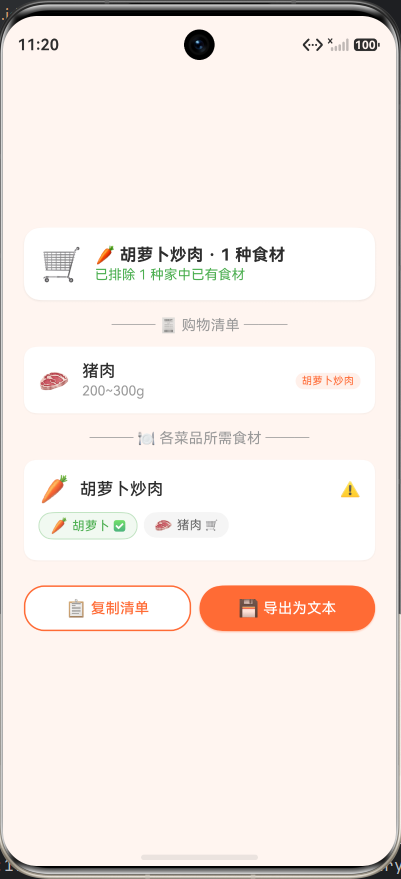

# 懂吃 DongChi · 今天吃什么，不再纠结

> 第九届传智杯全国大学生数智创新与AI应用大赛 · **AI 创新应用挑战赛（个人赛）** 参赛作品
> 平台：HarmonyOS 6.0.2（API 22）｜语言：ArkTS / ArkUI
>
> 代码仓库：<https://github.com/s1316339343/DongChi_V2.event_czb>　｜　许可证：MIT

> **评委快速入口**
> ① 只想看效果 → [4.1 直接装包体验（1 分钟）](#41-路径-a直接装包体验1-分钟)
> ② 想看界面 → [界面一览](#界面一览)
> ③ 想看过程真实性和演进链路 → [RECONSTRUCTION.md](RECONSTRUCTION.md)
> ④ 想看与 AI 的完整对话（逐轮原文） → [AI-PROMPTS/](AI-PROMPTS/README.md)
> ⑤ 想看设计与取舍 → [技术文档.pdf](技术文档.pdf)

---

## 一、项目简介

"今天吃什么"是每天要面对 3 次的高频决策，真正的难点不在"不知道有哪些菜"，而在于**约束条件下的取舍**：时间够不够、预算够不够、冰箱里还有什么、有没有忌口、**自己做还是点外卖更划算**。

懂吃是一套**决策系统**而非推荐工具：

```
三问渐进式收敛条件  →  AI 在合规候选内重排并解释  →  自己做 vs 外卖对比
                                                          ↓
                                            冰箱食材管理 + 购物清单闭环
```

### 核心差异化：把"吃什么"延伸到"怎么吃更划算"

多数推荐类应用只回答"吃什么"。懂吃对每道推荐菜同时给出：

| | 自己做 | 点外卖 |
|---|---|---|
| 耗时 | 烹饪时间 | 配送时间 |
| 花费 | 食材成本 | 外卖价格 |
| 食材 | **家里是否已有**（精确到缺哪几样） | 无需动手 |

并据此给出判断，例如："你家里已有大部分食材，只需补买紫菜就能做！"

---

## 二、AI 能力设计（核心）

### 2.1 设计原则

> **硬约束由确定性代码保证，生成式模型只负责它真正擅长的语义理解与解释。**

### 2.2 为什么不能"直接把条件丢给大模型"

早期实现是**一次裸调用**：把用户条件拼成 prompt，让模型直接输出 3 道菜的 JSON。实测暴露三类问题：

1. **幻觉** —— 模型推荐菜品库里不存在的菜，下游无法展示详情、无法算成本
2. **约束违反** —— 即使 prompt 写了"不吃辣"，仍可能推荐麻辣香锅
3. **事实失真** —— 模型自己编造价格与耗时，与本地数据不一致

**根因**：把「约束求解」和「语义理解」两类完全不同的任务交给了同一个组件。

### 2.3 三段式管道

```
┌─────────────────────────────────────────────────────────┐
│ ① 本地结构化检索（确定性）                                │
│   · 忌口一票否决（不吃辣/不吃香菜/不吃海鲜/素食）          │
│   · 预算硬过滤                                            │
│   · 多维加权评分（分类/时间/预算/食材匹配度）              │
│   498 道菜 ──▶ 约 12 个必然合规的候选                      │
└───────────────────────┬─────────────────────────────────┘
                        │
┌───────────────────────▼─────────────────────────────────┐
│ ② 云端 LLM 重排（语义）                                   │
│   · 只在候选集合内排序 → 从架构上杜绝幻觉                 │
│   · 结合"两个人吃""今天不想动手"等软信息生成个性化理由     │
└───────────────────────┬─────────────────────────────────┘
                        │
┌───────────────────────▼─────────────────────────────────┐
│ ③ 结构化校验（防幻觉闸门）                                │
│   · 候选白名单校验菜名    · 二次忌口校验                   │
│   · 分数夹取 0~100        · 理由截断与兜底                 │
└───────────────────────┬─────────────────────────────────┘
                 失败 ↙          ↘ 成功
        ┌──────────────┐   ┌──────────────────────┐
        │ ④ 本地降级    │   │ 数值与语义分离后合并   │
        │  模板理由     │   │ 时间/成本取自本地数据  │
        └──────────────┘   └──────────────────────┘
```

**关键设计：数值与语义分离。**
模型只决定排序与理由，所有时间 / 成本 / 食材是否齐备**一律取自本地数据**（`mergeRerankWithLocal`）。即使模型对价格判断有偏差，也不会污染用户看到的事实信息。

### 2.4 降级路径（异常处理）

| 触发条件 | 行为 |
|---|---|
| 未配置 API Key | 纯本地推荐，设置页提示填写 |
| 用户在设置中关闭 AI | 纯本地推荐 |
| 网络异常 / 超时 | 回退本地排序并说明原因 |
| 免费额度用尽（HTTP 403） | 回退本地排序，错误翻译为可懂文案 |
| 模型输出无法解析 | 自动重试一次（降温至 0.1），仍失败则回退 |
| 校验后无有效结果 | 回退本地排序 |

**降级不是补丁而是设计的一部分**：本地引擎本身就是完整可用的推荐器，云端 AI 提供的是"更贴合的排序与解释"这一增量价值。

---

## 三、功能清单

| 模块 | 说明 |
|---|---|
| 三问决策 | 口味方向 → 时间/预算/忌口 → 家中食材，逐步收敛 |
| AI 推荐 | 候选重排 + 个性化理由；支持"补充说明"输入软信息 |
| 自己做 vs 外卖 | 成本与时间对比，标注缺哪些食材 |
| 冰箱管理 | 多冰箱、七大分类、一键全选、自定义食材 |
| 购物清单 | 多菜食材合并去重、自动过滤家中已有、用量估算、导出 |
| 菜品详情 | 步骤与营养（已标注"通用做法 / 仅供参考"） |
| 收藏 / 决策记录 | 收藏反馈进推荐；记录可复现当时的决策 |
| 饮食仪表盘 | 口味分布、预算分布、时间偏好、消费趋势 |
| 语音播报 | TTS 播报推荐结果 |

### 界面一览

<table>
  <tr>
    <td width="33%" align="center"><br><sub><b>① 首页</b>　一句话定位 + 三个入口</sub></td>
    <td width="33%" align="center"><br><sub><b>② 第三问 · 冰箱食材</b>　七大分类，支持搜索与自定义</sub></td>
    <td width="33%" align="center"><br><sub><b>③ AI 决策过程</b>　三阶段进度 + 模型实时逐字输出</sub></td>
  </tr>
  <tr>
    <td align="center"><br><sub><b>④ 推荐结果</b>　自己做 vs 外卖、缺哪几样食材</sub></td>
    <td align="center"><br><sub><b>⑤ 购物清单</b>　多菜合并去重、自动过滤家中已有</sub></td>
    <td align="center"><sub>截图取自演示视频<br>（HarmonyOS 真机 / API 22）</sub></td>
  </tr>
</table>

> 第 ③ 张是评审标准里点名的"AI 响应状态提示"：左边三阶段（✅ 本地检索 → ⏳ 云端重排 → ○ 结构校验），
> 右边是模型正在逐字生成的原始输出。降级时只把出问题的那一步标成 ⚠️，不会假装全部成功。

---

## 四、10 分钟极速复现

> 三条路径，按目的选一条即可：
> **A → 只想看效果**（1 分钟，不装 IDE）｜**B → 想自己编译**（约 8 分钟）｜**C → 想跑测试**（约 5 分钟）

### 4.0 依赖清单（先看这个，决定你要不要装 IDE）

| 类别 | 依赖 | 版本 | 说明 |
|---|---|---|---|
| 运行时 | **无第三方运行时依赖** | — | `entry/oh-package.json5` 的 `dependencies` 为空，全部逻辑基于 ArkTS 标准库与 HarmonyOS Kit |
| 测试 | `@ohos/hypium` | 1.0.25 | 官方单测框架（devDependency） |
| 测试 | `@ohos/hamock` | 1.0.0 | 官方 mock 框架（devDependency） |
| 构建 | DevEco Studio | ≥ 6.1.1.280 | 提供 SDK / hvigor / JBR |
| 构建 | HarmonyOS SDK | 6.0.2（**API 22**） | 见 [build-profile.json5](build-profile.json5) 的 `compileSdkVersion` |
| 构建 | hvigor | 6.24.2 | 随 DevEco 附带 |
| 构建 | Node.js | 24.x | 随 DevEco 附带（`tools\node`） |
| 构建 | JDK | 21（DevEco 自带 JBR） | 打包步骤要求 `java` 在 PATH 中 |
| 数据 | 菜品库 / 详情库 | — | 498 道，随源码内置，**无需下载** |
| 可选 | 阿里云百炼 API Key | — | 不配置也能全功能使用（自动降级本地引擎） |

> **为什么没有 `package.json` / `npm install`**：这是纯 ArkTS 工程，不是 Web 前端。
> 依赖由 DevEco 的 SDK 与 ohpm 管理，`oh_modules/` 已在 `.gitignore` 中。

### 4.1 路径 A：直接装包体验（1 分钟）

1. 打开 [Releases](https://github.com/s1316339343/DongChi_V2.event_czb/releases/latest)，下载 `entry-default-signed.hap`；
2. 连上 API 22+ 的鸿蒙设备或模拟器，执行 `hdc install entry-default-signed.hap`（或把包拖进设备窗口）；
3. 打开「懂吃」，走一遍三问决策。

> 装包不需要 SDK、不需要编译。**评委若只想看效果，走这条。**
>
> ⚠️ **若下载失败**：GitHub 的 Release 资产域名（`objects.githubusercontent.com`）在国内部分网络不可达，
> 表现为点下载后一直转圈或超时。这不是文件问题，可改用下面任一条：
> ① 走 **4.2 从源码编译**（约 8 分钟，最稳）；② 向作者索取 HAP（提交材料中另附）；
> ③ 浏览器开启代理后重试该链接。

### 4.2 路径 B：从源码编译（约 8 分钟）

前置：安装 DevEco Studio 6.1.1.280+（含 HarmonyOS SDK API 22）。

```bash
git clone https://github.com/s1316339343/DongChi_V2.event_czb.git
cd DongChi_V2.event_czb
```

**① 设置环境变量**（模板见 [env.example.ps1](env.example.ps1) / [env.example.bat](env.example.bat)，只填路径、不含密钥）

```powershell
Copy-Item env.example.ps1 env.local.ps1   # 把里面的 DevEcoRoot 改成自己的安装位置
. .\env.local.ps1                          # 打印三个路径并自检是否存在
```

**② 编译**

```powershell
& $env:HVIGOR_BAT assembleHap --mode module -p product=default -p buildMode=debug --no-daemon
```

产物：`entry/build/default/outputs/default/entry-default-unsigned.hap`
（仓库不含签名口令，因此只产出 unsigned 包，属预期行为；要签名包见 4.5）

**③ 运行**：DevEco Studio 打开项目 → 等同步完成 → 连设备或启动模拟器 → 点 Run。

**④ 本机实测基线**：编译 19–28 秒，输出 `BUILD SUCCESSFUL`；
仅剩 `router / animateTo 已废弃` 一类告警，无 error。

### 4.3 路径 C：跑测试（约 5 分钟）

12 个用例，只覆盖 AI 校验闸门，**不依赖网络**。需真机或模拟器：

```powershell
& $env:HVIGOR_BAT assembleHap --mode module -p module=entry@ohosTest -p product=default
# 然后用 DevEco Studio 的 Test 运行器执行
```

覆盖：防幻觉（候选外菜名丢弃）、忌口拦截、数量截断、分数夹取、理由截断与兜底、
非 JSON 判定、重复菜名去重、markdown 围栏提取、嵌套 JSON、字符串内花括号。

### 4.4 配置云端 AI（可选）

不配置时 App **全功能可用**，仅推荐理由退化为模板文案。

```bash
# 方式一：配置文件（推荐，密钥不入库）
cp entry/src/main/resources/rawfile/ai-config.local.json.example \
   entry/src/main/resources/rawfile/ai-config.local.json
# 编辑 ai-config.local.json，填入你的百炼 API Key
```

```text
方式二：App 内填写
我的 → AI 能力设置 → 填入 API Key → 保存
```

**获取 API Key**：登录 [阿里云百炼控制台](https://bailian.console.aliyun.com/settings/api-key) 创建。
新用户每个模型约有 100 万 Token 免费额度，有效期 90 天。默认模型 `qwen-flash` 在免费额度覆盖范围内。

> **安全说明**：`ai-config.local.json` 已加入 `.gitignore`，不会进入版本库；
> 源码与提交历史中均不含明文密钥（可用 `git log -S "sk-" --oneline` 自查）。
> 生产环境建议改为服务端代理：把 `baseUrl` 指向自建接口即可，检索/重排/校验逻辑无需改动。

### 4.5 构建签名包（需要直装时才做）

仓库中的 `build-profile.json5` **不含任何签名口令**（`signingConfigs` 为空），
因此克隆后可直接编译出**未签名**包；要产出自用的**已签名**包，二选一：

**方式一：脚本注入（推荐，构建后自动还原配置）**

```bash
# 1) 准备本地私有签名配置（该文件已被 .gitignore 忽略）
cp signing/signing-config.example.json signing/signing-config.local.json
# 编辑 signing-config.local.json，填入你自己的证书路径与口令

# 2) 设置 hvigor 路径并构建
set HVIGOR_BAT=<DevEco Studio>\tools\hvigor\bin\hvigorw.bat
node scripts/build-signed.mjs
# 可选：node scripts/build-signed.mjs --buildMode release
```

脚本流程：读取本地签名 → 临时注入 `build-profile.json5` → 执行 hvigor →
**无论成功失败都还原配置**（并在下次启动时检测上次异常残留）。

**方式二：DevEco Studio 内配置**

`File > Project Structure > Signing Configs` 勾选自动生成或手动填写，
IDE 会在本地补全 `signingConfigs`（此改动仅存在于你的工作区，不应提交）。

> **安全说明**：签名口令只存在于 `signing/signing-config.local.json`（已 gitignore）。
> 证书文件（`.p12` / `.p7b` / `.cer`）同样不入库。

### 4.6 常见问题（复现时最容易卡住的四处）

| 现象 | 原因与处理 |
|---|---|
| `spawn java ENOENT` | 打包步骤要求 `java` 在 PATH 中：先 `. .\env.local.ps1`（或 `env.local.bat`） |
| `SDK not found` / 报 SDK 版本不符 | `DEVECO_SDK_HOME` 要指向 `...\DevEco Studio\sdk`，且 SDK 需含 API 22 |
| 编译成功但没有 signed 包 | **属预期**：仓库不含签名口令，见 4.5 |
| App 里 AI 总是走本地推荐 | ① 未配 Key；② 设置页里的 Key 是旧的（**Preferences 优先于 rawfile**）；③ 免费额度用尽（HTTP 403）。换 Key 请在「我的 → AI 能力设置」里粘贴保存 |

---

## 五、项目结构

```
entry/src/main/ets/
├── pages/                  15 个页面
│   ├── Index.ets           首页
│   ├── StepOne/Two/Three   三问决策
│   ├── Recommend.ets       推荐结果（含补充说明输入）
│   ├── DishDetail.ets      菜品详情
│   ├── FridgePage.ets      冰箱列表
│   ├── FridgeEditPage.ets  冰箱编辑
│   ├── ShoppingList.ets    购物清单
│   ├── Favorites.ets       收藏
│   ├── DecisionRecords.ets 决策记录
│   ├── DietDashboard.ets   饮食仪表盘
│   ├── AiSettings.ets      AI 能力设置
│   └── Profile/ProfileDetail
├── service/                服务层
│   ├── CloudAiService.ets  ★ AI 能力层（重排/校验/降级/密钥）
│   ├── RecommendService.ets★ 决策编排（三段式管道）
│   ├── DbService.ets       relationalStore 数据访问
│   ├── DishTypes.ets       类型与共享常量
│   ├── LocalDishes.ets     498 道菜品库（4 个分片）
│   ├── DishDetailData.ets  498 道步骤与营养
│   ├── IngredientCategories.ets 食材分类共享常量
│   ├── TtsService.ets      语音播报
│   └── FridgeState.ets     页面间状态传递
└── resources/              资源（含 rawfile 密钥配置模板）

entry/src/ohosTest/ets/test/
├── Ability.test.ets        模板自带的能力测试
├── AiPipelineTest.test.ets AI 链路单元测试（12 个用例）
└── List.test.ets           测试聚合入口
```

---

## 六、技术要点

### 性能
- 推荐引擎克隆次数由约 500 次降至 3 次（只克隆最终选中项）
- 打分权重移出 500 次循环，循环内只做增量计算
- 决策记录渲染不再每帧 `JSON.parse`
- 购物清单图标表与用量规则提升为模块常量

### 正确性
- 忌口双重校验：本地字段过滤 + 云端返回后菜名二次扫描
- 演示兜底数据不写入决策记录，避免污染统计
- 同一决策内的"换一批"不重复写库
- 偏好画像缓存于决策新增 / 删除 / 收藏变化时失效

### 健壮性
- JSON 提取采用**括号配对扫描**（非贪婪正则），可穿透 markdown 围栏与解释文字，并正确跳过字符串内花括号
- TTS 监听器按 `requestId` 校验归属，丢弃过期回调
- TTS 初始化使用 in-flight Promise，防止并发初始化泄漏引擎

---

## 七、凭据与安全

本仓库**不包含任何签名口令、证书文件或 API Key**，具体处置如下：

| 凭据 | 存放位置 | 是否入库 |
|---|---|---|
| 签名口令 | `signing/signing-config.local.json` | ❌ 已 gitignore |
| 签名证书 `.p12/.p7b/.cer` | 项目外（本地路径由上面文件指向） | ❌ 已 gitignore |
| 百炼 API Key | `rawfile/ai-config.local.json` 或应用 Preferences | ❌ 已 gitignore |
| AI 密钥模板 | `rawfile/ai-config.local.json.example` | ✅ 可入库 |
| 签名配置模板 | `signing/signing-config.example.json` | ✅ 可入库 |

> **关于历史版本**：早期提交曾把签名口令写在 `build-profile.json5` 中，
> 已通过重写历史彻底移除，并对全部提交校验过不含口令。
> 若你曾使用过该密钥库，**建议轮换签名口令并重新生成证书**。

---

## 八、文档索引

| 文档 | 内容 |
|---|---|
| [技术文档.pdf](技术文档.pdf) | **提交用正式版**（含封面/目录/图表/实测数据） |
| [技术文档.docx](技术文档.docx) | 上述 PDF 的可编辑源文件 |
| [技术文档.md](技术文档.md) | 架构设计、AI 原理、意图控制策略、测试方案、已知局限 |
| [AI-PROMPTS/](AI-PROMPTS/README.md) | **AI 对话原始记录**：4 条完整 Prompt 链（逐轮原文 + 落盘文件 + 工具动作） |
| [AI-PROMPTS.md](AI-PROMPTS.md) | 上述记录的导读：工具分工、关键对话清单、返工记录 |
| [RECONSTRUCTION.md](RECONSTRUCTION.md) | 提交历史重建说明（为什么重建、改了什么、如何核对与回滚） |
| [应用介绍.md](应用介绍.md) | 面向用户的功能与场景介绍 |

---

## 九、已知局限

| 局限 | 说明 |
|---|---|
| 营养数据为区间估算 | 按菜系粗分，页面已标注"仅供参考" |
| 步骤为通用做法 | 步骤文本模板化，页面已标注"通用做法" |
| 客户端持有密钥 | 反编译可提取；生产建议改服务端代理 |
| 使用旧版 router API | 编译存在弃用告警，计划迁移至 Navigation |
| 长列表未虚拟化 | 收藏/记录/冰箱页使用 `Scroll`+`ForEach` |

详见 [技术文档.md](技术文档.md) 第六章。
---

## 十、开源许可

本项目以 [MIT License](LICENSE) 开源，可自由用于学习、教学与二次开发。

欢迎提交 Issue 反馈问题；若用于竞赛或其他公开场合，请注明来源。

### 致谢

- [HarmonyOS](https://developer.huawei.com/) 提供开发框架与工具链
- [阿里云百炼](https://bailian.console.aliyun.com/) 提供大模型推理能力（通义千问）
